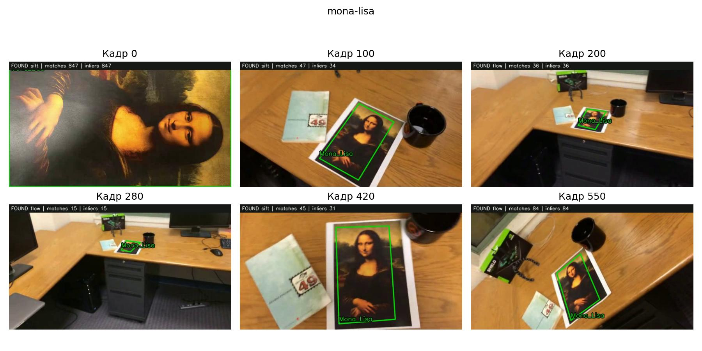
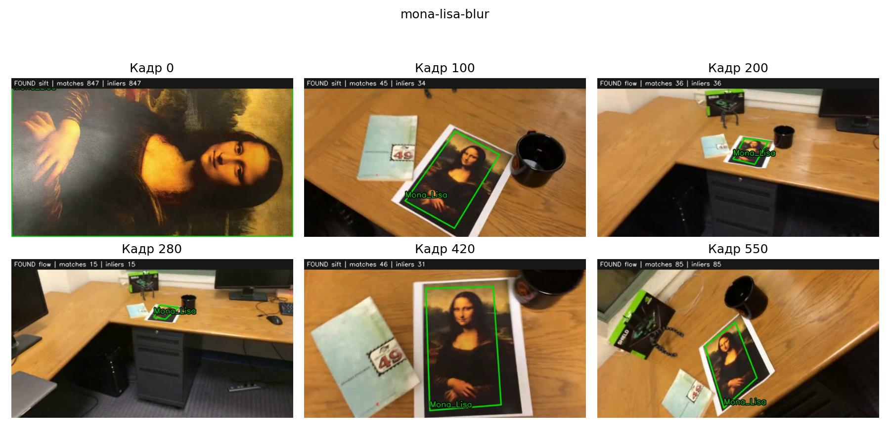
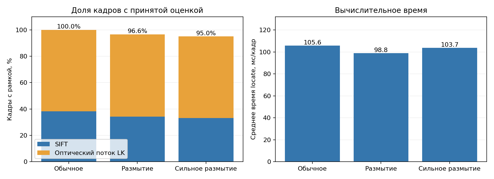
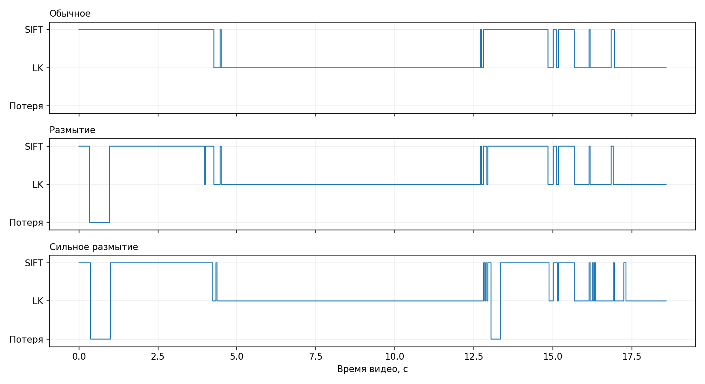
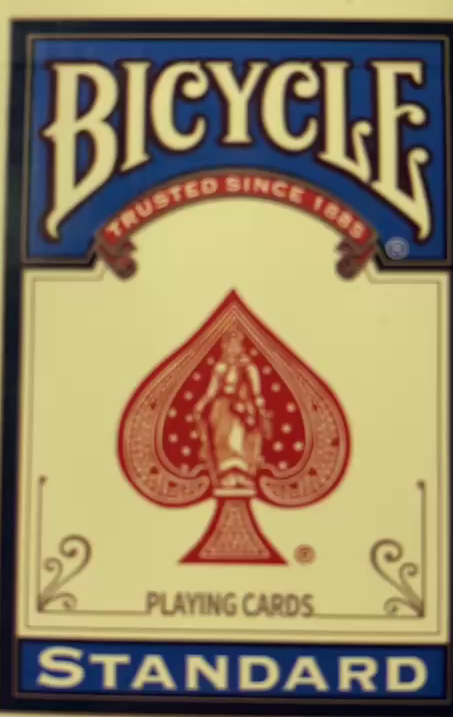
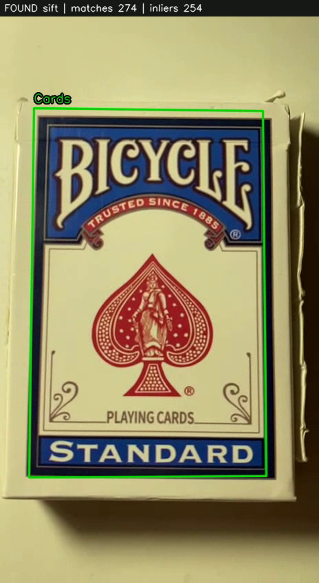
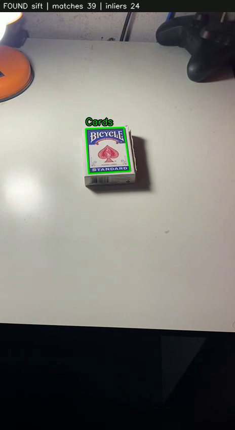
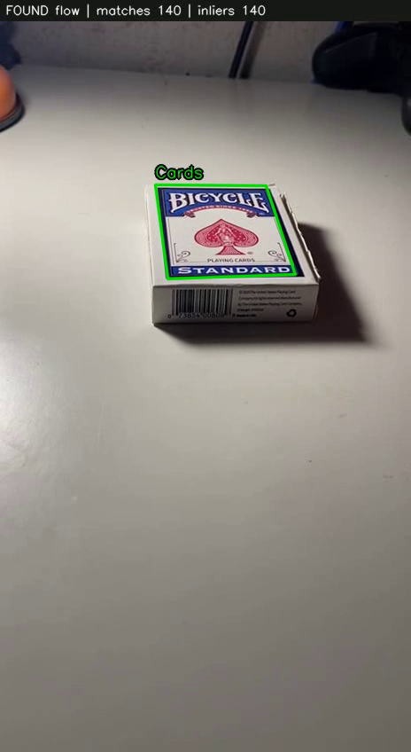
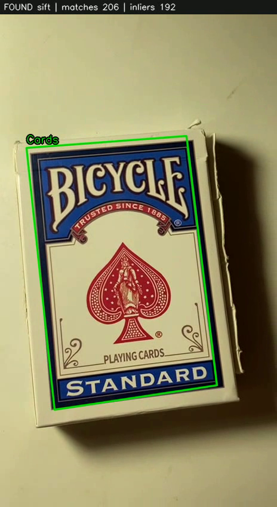

# Лабораторная работа № 2

**Тема:** трекинг плоского объекта на видео по ключевым точкам.  
**Цель:** определить положение объекта на каждом кадре и отобразить рамку с подписью.

Проект использует SIFT, сопоставление дескрипторов, гомографию RANSAC и резервное сопровождение точек методом Lucas–Kanade. 

## Быстрый запуск

```bash
python -m pip install -r requirements.txt
python main.py videos/mona-lisa.avi --show --label Mona_Lisa --output output_demo
```

Результат появится в `output_demo/tracked.mp4`. Образец берётся из первого кадра. Без `--show` обработка выполняется без окна. Для остановки окна — `Q` или `Esc`; в этом случае обработается только часть видео.

Для своего ролика:

```bash
python main.py videos/my_video.mp4 --select --show --label My_Object --output output_my_video
```

Выделите объект целиком на первом кадре и нажмите `Enter`. Подробнее — [RUNBOOK.md](RUNBOOK.md).

## 1. Теоретическая база

### Ключевые точки и соответствия

Ключевые точки — характерные локальные детали изображения. SIFT находит такие детали и вычисляет числовые описания их окрестностей, дескрипторы. Это позволяет сопоставлять объект с его изображением при изменении масштаба, поворота и умеренном изменении ракурса [1].

FLANN ищет двух ближайших кандидатов для каждого дескриптора образца. Используется ratio test:

$$d_1 < 0.75d_2,$$

где $d_1$ и $d_2$ — расстояния до первого и второго кандидатов. Если расстояния почти одинаковы, совпадение неоднозначно и отбрасывается [1]. Повторное использование одной точки текущего кадра также исключается.

### Гомография и RANSAC

Поскольку объект плоский, его положение описывается гомографией — матрицей $H$ размером $3\times3$:

$$s\begin{bmatrix}x'\\y'\\1\end{bmatrix}
=H\begin{bmatrix}x\\y\\1\end{bmatrix}.$$

Она переводит координаты образца в координаты текущего кадра. Множитель $s$ учитывает однородные координаты; после умножения первые две координаты делятся на третью. Для определения гомографии нужны не менее четырёх пар точек в невырожденном расположении.

RANSAC оценивает преобразование при наличии ошибочных соответствий. Точки, согласующиеся с моделью, называются **inliers**. Гомография переносит четыре угла образца; они образуют рамку, которая может менять форму при перспективном наклоне объекта [1].

### Резервное сопровождение LK

Когда объект становится маленьким или размытым, независимому поиску SIFT может не хватать соответствий. Тогда Lucas–Kanade переносит точки с предыдущего кадра. Используется проверка «вперёд — назад»: точка переносится в новый кадр и обратно, после чего сравнивается с исходной позицией. Принимается обратная ошибка меньше 1.5 пикселя.

Для переноса выбираются углы Shi–Tomasi внутри текущей рамки через `goodFeaturesToTrack`. По перенесённым точкам снова оценивается гомография. Эти операции доступны в OpenCV [2].

## 2. Описание разработанной системы

### Алгоритм

1. Прочитать первый кадр, при необходимости уменьшить его и выбрать образец объекта.
2. Один раз вычислить SIFT-точки и дескрипторы образца.
3. На каждом кадре найти SIFT-точки, сопоставить их с образцом и оценить гомографию.
4. Если оценка не принята, попробовать LK с предыдущего успешного кадра.
5. Проверить число inliers, геометрию и видимость рамки.
6. При успехе нарисовать рамку и подпись, подготовить точки для следующего LK. При неудаче вывести `NOT FOUND` и сбросить состояние точек.
7. Записать кадр и метрики.

SIFT пробуется на каждом кадре независимо от результата LK. Поэтому после потери объект может быть найден заново; периодический успех SIFT также корректирует накопленное смещение LK. Прежняя рамка не рисуется просто потому, что она была на предыдущем кадре.

### Основные параметры

| Параметр | Значение |
| --- | --- |
| SIFT | `nfeatures=2000`, `contrastThreshold=0.02` |
| FLANN | KD-tree, `trees=5`, `checks=50` |
| Ratio test | 0.75 |
| Минимум SIFT-соответствий | 12 |
| Принятие SIFT-гомографии | Не менее 12 inliers и доля не меньше 0.5 |
| Допуск RANSAC для SIFT | 5 пикселей |
| LK | Окно 21 × 21, `maxLevel=3` |
| Обратная ошибка LK | Меньше 1.5 пикселя |
| Принятие LK-гомографии | Не менее 8 inliers и доля не меньше 0.6 |
| Допуск RANSAC для LK | 3 пикселя |
| Точки для следующего LK | До 300 углов, расстояние между ними от 5 пикселей |
| Максимальная ширина кадра | 960, пропорции сохраняются |

Дополнительно проверяются конечность координат, выпуклость рамки, площадь от 100 пикселей² до 1.5 площади кадра и пересечение с видимой областью. Это эвристики для отбрасывания явно неверных оценок, а не гарантия точного положения.

### Архитектура и файлы

| Файл | Назначение |
| --- | --- |
| `main.py` | Алгоритм трекинга, выбор образца, чтение и запись видео, командная строка |
| `experiment.py` | Последовательный прогон трёх тестов, сводная таблица и графики |
| `test_tracker.py` | Семь автоматических проверок |
| `requirements.txt` | Зависимости |
| `videos/` | Три исходных видео из задания |
| `results/` | Готовые выходные видео, образцы, CSV и JSON каждого запуска |
| `assets/` | Примеры кадров и графики отчёта |
| `results.csv`, `environment.json` | Сводные измерения и сведения о среде |
| `RUNBOOK.md` | Установка, команды, собственное видео и порядок демонстрации |
| `DEFENSE.md` | Короткая речь и ответы на вопросы |
| `CODE_EXPLANATION.md` | Подробный разбор функций и важных строк |
| `docs/LR2_Code_Explanation.pdf` | Разбор кода в PDF |

Функции алгоритма переиспользуются экспериментом: отдельной копии трекера в `experiment.py` нет. Файл `simple_track.avi` из приложенного архива использован только как визуальный пример ожидаемого результата, а не как вход тестирования; он уже содержит чужую разметку.

### Команды

Повторить полный эксперимент:

```bash
python experiment.py
```

Только перестроить материалы из уже готовых полных результатов:

```bash
python experiment.py --reuse
```

Запустить проверки:

```bash
python -m unittest -v test_tracker
```

При повторном запуске файлы результатов перезаписываются.

## 3. Результаты работы и тестирования системы

### Данные и методика

Обработаны все кадры трёх предоставленных видео: `mona-lisa.avi`, `mona-lisa-blur.avi`, `mona-lisa-blur-extra-credit.avi`. Каждый содержит **558 кадров**, размер **640 × 360**, FPS **29.97**. Входные кадры не уменьшались. Параметры алгоритма одинаковы для трёх роликов. Образец — весь первый кадр, на котором репродукция показана крупно.

Отслеживаются границы выбранного образца. В этих видео первый кадр не включает всю белую полиграфическую окантовку листа, поэтому зелёная рамка соответствует области самой репродукции. Для собственного объекта выбор на первом кадре определяет, какие границы будут переноситься.

**Среда расчёта:** Python 3.12.14, OpenCV 4.12.0, NumPy 2.2.6. Для OpenCV задан один поток и фиксированное начальное состояние генератора RANSAC. Вычисления и запись проверены в среде без графического интерфейса; `--show` и `--select` предназначены для локального запуска с обычной `opencv-python` из requirements.

Время измерено через `perf_counter` только вокруг вызова `locate`: SIFT, возможный LK, оценка геометрии и подготовка точек. Декодирование, отрисовка, запись и показ видео сюда не входят. Указана средняя длительность по всем кадрам одного полного прогона каждого видео. Это не медиана нескольких независимых запусков, как в ЛР1. FPS вычисляется как `1000 / mean_ms` и характеризует данный вычислительный участок.

| Видео | Кадры с рамкой | Доля | SIFT | LK | Среднее время, мс | Вычислительный FPS |
| --- | ---: | ---: | ---: | ---: | ---: | ---: |
| mona-lisa.avi | 558 / 558 | 100.00% | 213 | 345 | 105.63 | 9.47 |
| mona-lisa-blur.avi | 539 / 558 | 96.59% | 191 | 348 | 98.80 | 10.12 |
| mona-lisa-blur-extra-credit.avi | 530 / 558 | 94.98% | 185 | 345 | 103.73 | 9.64 |

**Важно:** доля кадров с принятой рамкой - показатель непрерывности, а не точность локализации. Эталонной покадровой разметки нет, поэтому IoU и доля правильных рамок не вычислялись. Высокая доля inliers также не является вероятностью правильного обнаружения.

### Обычное видео



[Полный результат MP4](results/mona-lisa/tracked.mp4) · [Покадровые метрики](results/mona-lisa/metrics.csv) · [Сводка](results/mona-lisa/summary.json)

Рамка получена на всех кадрах этого запуска. На дальнем участке сопровождение продолжает LK, а при приближении независимые сопоставления SIFT снова становятся устойчивее.

### Видео с размытием



[Полный результат MP4](results/mona-lisa-blur/tracked.mp4) · [Покадровые метрики](results/mona-lisa-blur/metrics.csv) · [Сводка](results/mona-lisa-blur/summary.json)

В размытых кадрах часть локальных деталей теряется. LK помогает сохранить сопровождение, но на части кадров оба метода не проходят проверки и рамка отсутствует.

### Дополнительное видео с сильным размытием


[Полный результат MP4](results/mona-lisa-blur-extra-credit/tracked.mp4) · [Покадровые метрики](results/mona-lisa-blur-extra-credit/metrics.csv) · [Сводка](results/mona-lisa-blur-extra-credit/summary.json)

В этом прогоне доля кадров с рамкой ниже. Сложные участки сильнее зависят от резервного LK. Отдельные потери присутствуют и не скрываются повторением последней рамки.

### Графики



Слева синим показаны кадры SIFT, оранжевым — LK. Высота столбца равна общей доле принятых оценок. Справа показано среднее время `locate` на кадр. Время зависит от нагрузки и компьютера; отсутствие реального времени не мешает сохранить и показать готовый ролик.



На временной шкале видно, когда работал независимый поиск, когда использовался LK и когда была потеря. Кадры сеток выбраны по фиксированным номерам 0, 100, 200, 280, 420 и 550; полную последовательность следует оценивать по видео.

### Автоматические проверки

Выполнены **7 проверок**, все пройдены:

1. Образец найден на собственном изображении, ошибка углов меньше 1 пикселя.
2. Объект найден после известного перспективного преобразования; максимальная ошибка углов меньше 4 пикселей.
3. Резервный LK проверен отдельно при принудительно отключённом SIFT, ошибка углов меньше 3 пикселей.
4. Объект потерян на чёрном кадре и найден снова при возвращении образца.
5. Пустой образец отклонён с понятной ошибкой.
6. Уменьшение кадра сохраняет пропорции и не увеличивает маленький кадр.
7. Отсутствующий видеофайл приводит к явной ошибке.

Сохранённые MP4 дополнительно проверены на читаемость и число кадров; выбранные кадры просмотрены визуально. Проверки не гарантируют правильную рамку на любом видео.

### Собственное видео

Для проверки использовано собственное видео **`my_video.mov`**. Объект — плоская лицевая поверхность коробки покерных карт **Bicycle Standard**. Коробка лежит на светлом столе; камера сначала показывает её крупно, затем отдаляется, меняет ракурс и возвращается ближе. Видео вертикальное, рабочий размер кадра — **464 × 848 пикселей**.

Образец выбран на первом кадре: ROI **X = 8, Y = 39, ширина = 453, высота = 717**. Отслеживается область лицевого рисунка, а не все грани объёмной коробки. Команда для повторения с тем же исходным видео и сохранёнными координатами:

```bash
python main.py videos/my_video.mov --roi 8 39 453 717 --show --label Cards --output output_my_video
```

Для новой съёмки координаты нужно выбрать заново через `--select`.

#### Выбранный образец



Это копия `template.png` из результатов обработки. В образце есть контрастные надписи и рисунок, подходящие для поиска ключевых точек. На образце найдено **1083 SIFT-точки**.

#### Начало видео — крупный план



**Кадр 71, 2.37 с.** Рамка охватывает выбранную лицевую область. Используется **SIFT**: 274 соответствия, из них 254 inliers.

#### Отдаление камеры



**Кадр 282, 9.41 с.** Объект занимает меньшую часть кадра, но независимый поиск **SIFT** по-прежнему даёт принятую оценку: 39 соответствий, 24 inliers.

#### Изменение ракурса



**Кадр 423, 14.12 с.** При наклоне камеры лицевая поверхность выглядит трапецией. В этом кадре применяется резервный **Lucas–Kanade**: 140 точек прошли проверку переноса, все 140 согласованы с гомографией. Рамка относится к верхней лицевой поверхности и не должна охватывать боковую грань со штрихкодом.

#### Возвращение камеры ближе к объекту



**Кадр 776, 25.90 с.** После приближения объект снова сопровождается через **SIFT**: 206 соответствий, 192 inliers.

#### Результаты обработки собственного видео

Числа взяты из предоставленных `summary.json` и `metrics.csv` и проверены между собой. Выходной MP4 полностью прочитан: в нём 777 кадров, что совпадает с числом строк CSV.

| Показатель | Значение |
| --- | ---: |
| Рабочий размер кадра | 464 × 848 пикселей |
| FPS по метаданным | 29.96 |
| Расчётная длительность — число кадров / FPS | 25.93 с |
| Обработано кадров | 777 |
| Кадров с принятой рамкой | 777 |
| Доля кадров с рамкой | 100.00% |
| Кадров с SIFT | 723 (93.05%) |
| Кадров с LK | 54 (6.95%) |
| Кадров без принятой рамки | 0 |
| Среднее время `locate` | 88.14 мс/кадр |
| Медианное время `locate` | 83.74 мс/кадр |
| Вычислительная скорость `locate` | 11.35 кадра/с |
| Время основного цикла из сводки | 80.06 с |

[Видео с рамкой и подписью](results/my-video/tracked.mp4) · [Покадровые метрики](results/my-video/metrics.csv) · [Сводка запуска](results/my-video/summary.json)

На выбранных кадрах рамка остаётся на лицевой поверхности при изменении масштаба и ракурса. По покадровой статистике потерь принятой оценки не было; часть кадров сопровождалась резервным LK. Это подтверждает непрерывность сопровождения в данном запуске.

## 4. Выводы по работе

Реализован трекинг плоского объекта по ключевым точкам с рамкой и подписью. SIFT обеспечивает независимый поиск по образцу, RANSAC отбрасывает часть ошибочных соответствий, гомография описывает перспективную форму рамки. LK поддерживает сопровождение на участках, где независимый поиск затруднён.

Все три предоставленных ролика обработаны полностью. В обычном видео рамка принималась на всех кадрах; при размытии появились потери. Система пригодна для демонстрации на текстурных плоских объектах, но сильное размытие, блики, резкие движения и перекрытие могут привести к потере или ошибке рамки. При длительном LK возможен дрейф.

Дополнительно обработано собственное видео с коробкой покерных карт Bicycle Standard: принятая рамка получена на всех 777 кадрах. На выбранных кадрах лицевая область сопровождается при отдалении, наклоне и повторном приближении камеры. SIFT использовался на 723 кадрах, LK — на 54. Результат показывает непрерывное сопровождение в этом запуске; точность границ по эталонной разметке не измерялась.

## 5. Использованные источники

1. [OpenCV 4.12 — Feature Matching + Homography to find Objects](https://docs.opencv.org/4.12.0/d1/de0/tutorial_py_feature_homography.html) — SIFT, сопоставление, ratio test и гомография с RANSAC.
2. [OpenCV 4.12 — Optical Flow](https://docs.opencv.org/4.12.0/d4/dee/tutorial_optical_flow.html) — Shi–Tomasi и Lucas–Kanade.
3. [Текст задания LW2_25.pdf](docs/LW2_25.pdf) и `test-videos.zip`, предоставленные вместе с заданием — требования, три тестовых видео и образец результата.

4. Собственное видео `my_video.mov` и предоставленные результаты его обработки.

Изображения и графики отчёта получены из реальных запусков.
